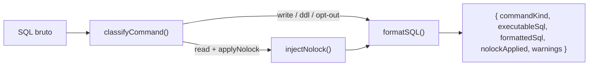

# Pipeline SQL (`@sequelei/core`)

O pipeline unificado de preparação de SQL está em [`packages/core/sql-pipeline.ts`](../packages/core/sql-pipeline.ts) e compõe as camadas puras do domínio sem dependência de UI, banco ou Tauri.

## Fluxo

## Módulos

1. **`errors.ts` (`SequeleiError` / `InvalidSqlError`)**
   - Códigos tipados: `EMPTY_SQL`, `INVALID_SQL`, `MALFORMED_SQL`, `UNSUPPORTED_COMMAND`.
2. **`command-classifier.ts` (`classifyCommand`, `stripLeadingComments`)**
   - Ignora comentários iniciais (`--` e `/* */`) e blocos `if exists (...)`.
   - Classifica em `'read' | 'write' | 'ddl'`.
3. **`highlighter.ts` (`tokenize`, `KEYWORDS`, `FUNCS`, `TYPES`)**
   - Tokenização contextual sem interpretar palavras dentro de strings ou comentários.
4. **`nolock-injector.ts` (`findTableReferences`, `injectNolock`)**
   - Injeta `with (nolock)` em tabelas referenciadas em `FROM`/`JOIN`, incluindo aliases, nomes com colchetes `[dbo].[Tabela]`, CTEs (aplica nas tabelas base, nunca na própria CTE), subconsultas e `UNION`.
   - Não duplica `with (nolock)` ou `(nolock)` legado.
   - Não sobrescreve hints existentes diferentes (ex.: `with (index(...))`), emitindo aviso.
   - Não aplica em comandos de escrita (`insert`, `update`, `delete`, `merge`, `truncate`) nem DDL.
   - **Limitações conhecidas:** SQL dinâmico montado em strings (`exec (@sql)`) não é reescrito; em views conhecidas (passadas via `options.views`), `with (nolock)` é aplicado na referência da view com aviso informativo porque a definição interna da view reside no servidor.
5. **`formatter.ts` (`formatSQL`, `FORMAT_RULES`)**
   - Aplica regras puras sobre os tokens:
     - `lowercaseKeywordsRule`: keywords e `nolock` em minúsculas.
     - `lowercaseNativeFunctionsRule`: funções nativas T-SQL em minúsculas, preservando UDFs.
     - `lowercaseDataTypesRule`: tipos de dados em minúsculas.
   - Preserva capitalização de identificadores e comentários.
   - Aplica indentação de 4 espaços e quebras de linha em `select` com múltiplas colunas, `from`, joins, `on`, `where`, `group by`, `having`, `order by`, `union`.
   - Idempotente (`formatSQL(formatSQL(sql)) === formatSQL(sql)`).
   - **Não** injeta `with (nolock)` diretamente (responsabilidade separada, composta por `prepareSql`).
